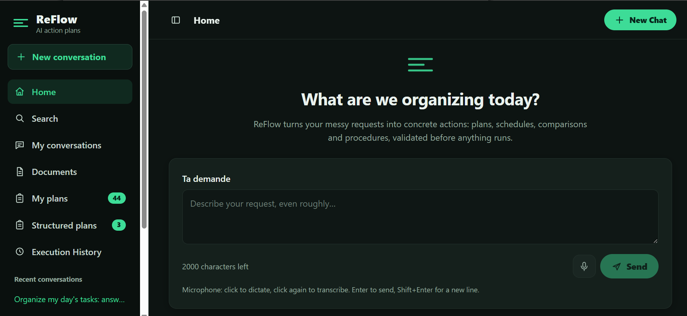
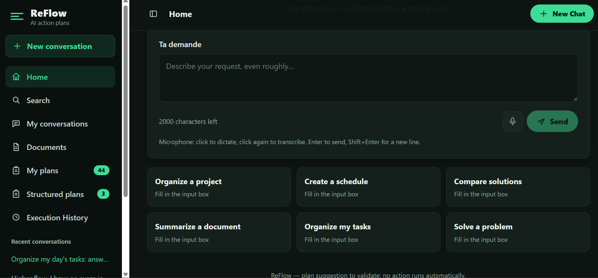
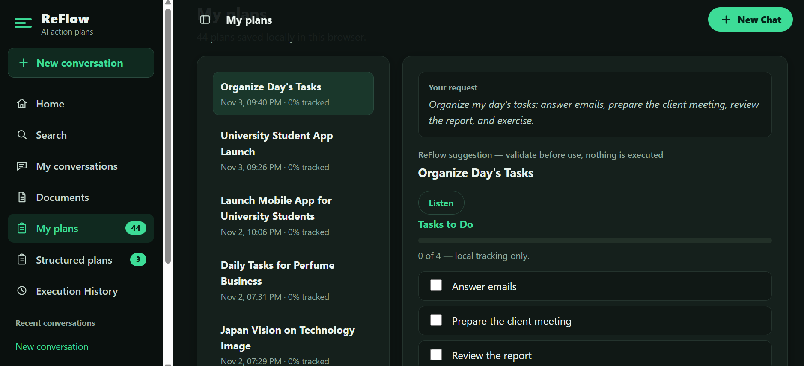
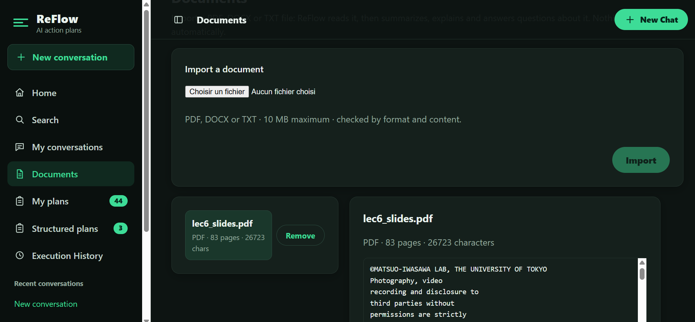
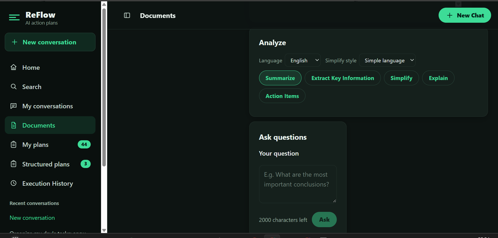

# ReFlow — Your AI-Powered Productivity Agent

**Turn unstructured information into clear plans and actionable workflows.**

ReFlow is an AI-powered productivity agent built for the Meta Global AI Developer Hackathon. It transforms unorganized requests, messages, documents, and visual inputs into structured action plans, helping users save time and focus on what matters.

Powered by Meta Model API, ReFlow combines multimodal AI capabilities with human-approved task execution to turn information into action while keeping users in control.

## Key Features

- **AI Action Planning:** Transform natural-language requests into structured, actionable plans.
- **Document Intelligence:** Upload PDF, DOCX, and TXT files to summarize, extract key information, simplify content, answer questions, and identify action items.
- **Voice Interaction:** Communicate with the assistant through voice transcription and conversational interactions.
- **Multimodal AI:** Understand visual inputs, generate and edit images, and perform image segmentation.
- **Human-in-the-Loop Execution:** Review and approve proposed plans before execution.
- **Conversation History:** Keep track of previous interactions and generated plans.

## Screenshots

### Main Interface





### AI Action Planning




### Document Intelligence





### Multimodal Image Capabilities


### Voice Interaction


## Technology Stack

**Backend**
- Python
- FastAPI
- Pydantic
- OpenAI Python SDK

**Frontend**
- React
- Vite
- JavaScript

**AI**
- Meta Model API
- Muse Spark models
- Multimodal AI capabilities

## Architecture

ReFlow follows a client-server architecture:

1. The React frontend provides the user interface.
2. The FastAPI backend handles requests, application logic, and workflows.
3. The backend communicates with Meta Model API for AI-powered capabilities.
4. Proposed actions are presented to the user for review and approval before execution.

## Getting Started

### Prerequisites

- Python 3.10 or later
- Node.js and npm
- A Meta Model API key

### 1. Clone the repository

```bash
git clone https://github.com/AdnHiba56/ReFlow.git
cd ReFlow
```

### 2. Set up the backend

Create a virtual environment:

```bash
python -m venv .venv
```

On Windows PowerShell:

```powershell
.\.venv\Scripts\Activate.ps1
```

On macOS/Linux:

```bash
source .venv/bin/activate
```

Install Python dependencies:

```bash
pip install -r requirements.txt
```

### 3. Configure environment variables

On Windows PowerShell:

```powershell
Copy-Item .env.example .env
```

On macOS/Linux:

```bash
cp .env.example .env
```

Open `.env` and add your Meta Model API key using the variable name specified in `.env.example`.

**Security:** Never commit or share your `.env` file or API key.

### 4. Start the backend

From the project root:

```bash
uvicorn main:app --reload
```

Backend: `http://127.0.0.1:8000`

API documentation: `http://127.0.0.1:8000/docs`

### 5. Start the frontend

Open a second terminal:

```bash
cd frontend
npm install
npm run dev
```

Open the local frontend URL displayed by Vite, usually:

`http://localhost:5173`

## Project Structure

```text
ReFlow/
├── frontend/          # React + Vite application
├── screenshot/        # Application screenshots
├── main.py            # FastAPI application
├── requirements.txt   # Python dependencies
├── .env.example       # Environment configuration template
├── .gitignore
└── README.md
```

## Project Status

ReFlow is under active development.

The source code is available on GitHub. The application currently runs locally; public deployment is not yet available.

## Vision

ReFlow aims to reduce the time and mental effort spent organizing everyday tasks by turning scattered information into meaningful, user-approved actions.

**Less time organizing. More time doing.**

## Author

Developed independently for the **Meta Global AI Developer Hackathon**.

GitHub: [AdnHiba56](https://github.com/AdnHiba56)

## License

A license has not yet been selected for this project.